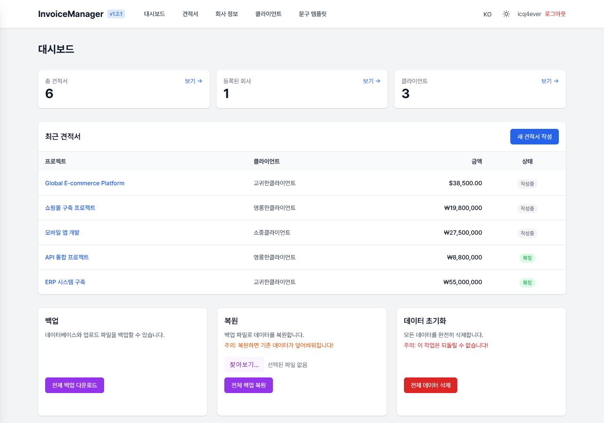
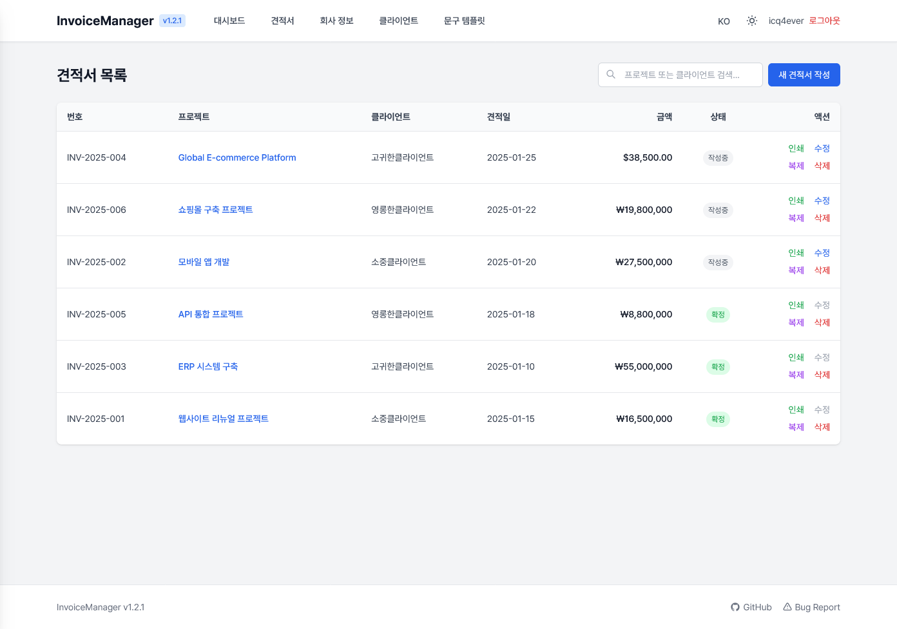
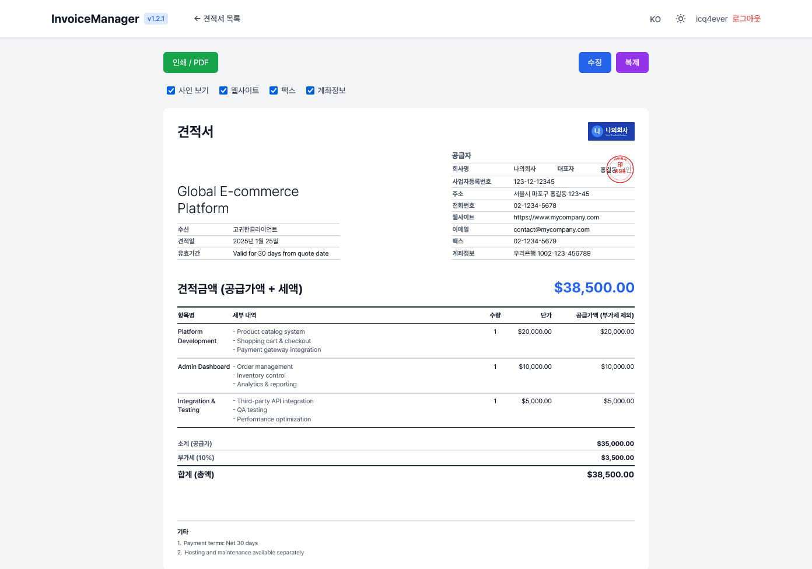
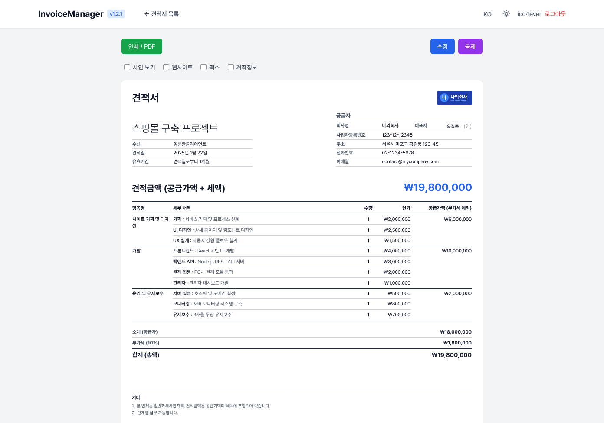
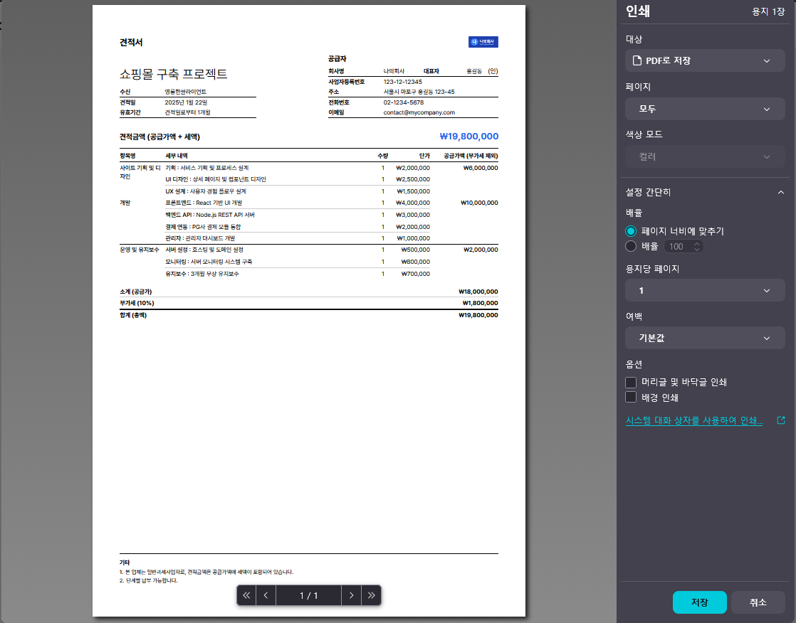
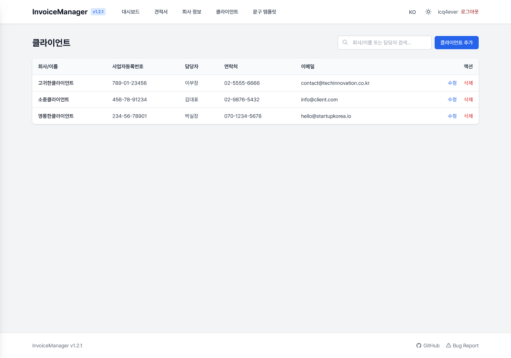

# 견적서 관리 시스템 (Invoice Manager)

다국어 지원(한글/영문)하는 자체 호스팅 기반 견적서 생성 및 관리 웹 애플리케이션입니다.

[](https://github.com/icq4ever/invoiceManager) 

**언어**: [English](README.md) | [한국어](README.ko.md)

## 주요 기능

- 다중 회사 견적서 생성
- 다국어 지원 (한글/영문)
- 거래처 관리
- 동적 항목 추가 및 자동 계산
- 재사용 가능한 기타 문구 템플릿
- PDF 내보내기 및 인쇄
- 다크 모드 지원
- 백업 & 복원
- Docker 배포 지원

## 미리보기

### 대시보드


### 견적서 목록


### 견적서 작성 - 단순 텍스트 모드


### 견적서 작성 - 세부항목 모드


### 견적서 인쇄 미리보기


### 클라이언트 목록


## 빠른 시작

```bash
# 저장소 복제
git clone https://github.com/yourusername/invoice-manager.git
cd invoice-manager

# 환경설정
cp .env.example .env
# .env 파일 수정

# Docker로 실행
docker-compose up --build -d

# 관리자 계정 설정
docker exec -it invoice-manager npm run set-credentials

# http://localhost:3006 접속
```

### 공유 Nginx 리버스 프록시 사용 시

하나의 Nginx 컨테이너로 여러 서비스를 리버스 프록시하는 환경에서는 invoice-manager를 해당 공유 네트워크에 연결해야 합니다:

```bash
# 공유 네트워크에 연결 (docker compose up 이후 실행)
docker network connect shared invoice-manager

# Nginx 리로드
docker exec nginx nginx -s reload
```

또는 `docker-compose.yml`의 `networks.shared`에서 `external: false`를 `external: true`로 변경하면 자동으로 기존 네트워크에 참여합니다.

## 기술 스택

- **백엔드**: Node.js + Express.js
- **데이터베이스**: SQLite
- **프론트엔드**: EJS + Tailwind CSS
- **배포**: Docker

## 문서

| 문서 | 설명 |
|------|------|
| [설치 가이드](docs/installation.md) | 설치 방법 & 환경 변수 |
| [사용 가이드](docs/usage.md) | 애플리케이션 사용법 |
| [Docker 배포](docs/docker.md) | Docker 배포 & Nginx 설정 |
| [데이터베이스](docs/database.md) | 데이터베이스 스키마 참조 |
| [문제 해결](docs/troubleshooting.md) | 일반적인 문제 & 해결책 |

## 후원

Invoice Manager가 도움이 되었다면 개발을 지원해주세요:

- [GitHub Sponsors](https://github.com/sponsors/icq4ever)
- 카카오페이: <br/>


## 라이선스

**GNU Affero General Public License v3 (AGPL v3)**

- 자유롭게 사용 및 수정 가능
- 수정 사항은 AGPL v3로 공유 필수
- 웹 서비스 사용 시 소스 코드 공개 필수

자세한 내용은 [LICENSE](LICENSE) 파일 참고.

## 로드맵

- [x] 견적서 상태 관리 (작성중, 확정, 폐기)
- [x] 이메일로 견적서 전달
- [ ] 결제 추적
- [ ] 다중 사용자 지원

## 기여

1. 저장소 포크
2. 기능 브랜치 생성
3. 풀 리퀘스트 제출

## 변경 이력

전체 변경 이력은 [CHANGELOG.md](CHANGELOG.md#korean)를 참고하세요.

---

**버전**: 1.4.1 | Node.js, Express, Tailwind CSS로 제작
